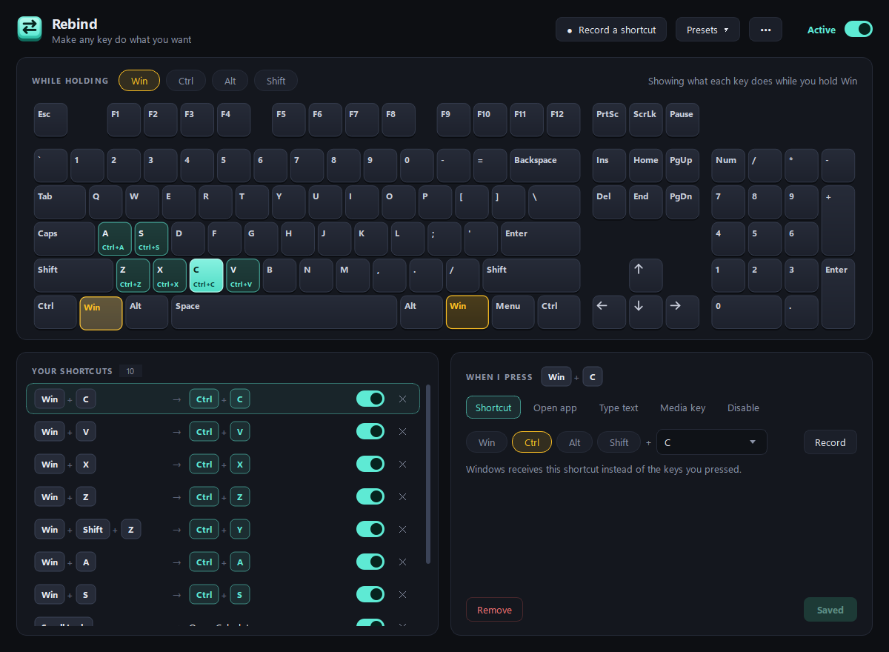
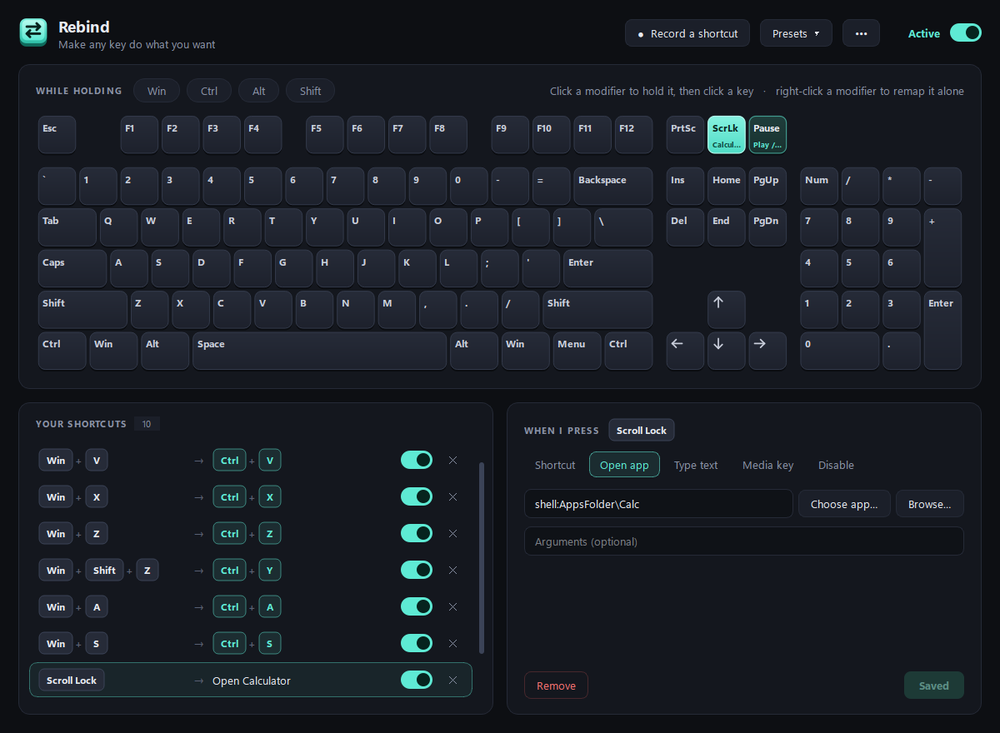

<p align="center"></p>

<h1 align="center">Rebind</h1>

<p align="center">Remap keyboard shortcuts on Windows by clicking a picture of the keyboard.</p>



## What it does

| You press | Rebind can |
| --- | --- |
| A shortcut, such as Win + C | Send another shortcut, such as Ctrl + C |
| A key you never use, such as Scroll Lock or Pause | Open an app, file, folder or web address |
| Any key or shortcut | Type a piece of text, such as an email address |
| Any key or shortcut | Act as a media key: volume, mute, play/pause, next track |
| A key you keep hitting by accident | Do nothing |

Remapped keys turn mint and show what they do on the keycap. Keys light up as you type, so you can see which
physical key is which.

## Using it

1. Click **Win**, **Ctrl**, **Alt** or **Shift** on the keyboard to choose what is held. Held modifiers turn amber.
2. Click the key you want to change. The editor opens on the right.
3. Choose what it should do and press **Save shortcut**.

Other ways in:

- **Record a shortcut**: press the combination on your real keyboard instead of clicking it.
- **Right-click a modifier** to remap that key on its own, for example Right Ctrl by itself.
- **Presets > Mac-style shortcuts** adds copy, paste, cut, undo, redo, save, find and more in one click, with either
  the Win key or the Alt key standing in for Command.

Each shortcut has its own on/off switch, and the switch in the top right pauses everything.



Closing the window keeps Rebind running in the notification area so your shortcuts keep working. Right-click the
tray icon to pause or quit. **Start with Windows** is in the `•••` menu.

## Install

Rebind runs on Windows 10 and 11 (64-bit). There is no installer.

1. Download `Rebind-1.0.0-windows-x64.zip` from the [latest release](https://github.com/offport/rebind/releases/latest).
2. Unzip it anywhere and run `Rebind\Rebind.exe`.

The build is not code-signed, so Windows SmartScreen may warn the first time. Choose **More info > Run anyway**.

### Build it yourself

Needs Python 3.12.

```powershell
git clone https://github.com/offport/rebind.git
cd rebind
.uild.ps1
.\dist\Rebind\Rebind.exe
```

`build.ps1` creates a virtual environment, installs PySide6, runs the tests, draws the icon and builds
`dist\Rebind\Rebind.exe` with PyInstaller. The `dist\Rebind` folder is self-contained and can be moved anywhere.

To run from source instead:

```powershell
py -3.12 -m venv .venv
.venv\Scripts\pip install -r requirements.txt
.venv\Scripts\python run.py
```

## Limits

- Windows keeps **Win + L** and **Ctrl + Alt + Delete** for itself. They cannot be remapped.
- Shortcuts do not reach windows that run **as administrator** (Task Manager, an elevated terminal) unless Rebind
  itself is started as administrator. Windows applies this rule to every app of this kind.
- Shortcuts apply in every app. There are no per-app rules.
- Some games and anti-cheat systems read the keyboard below the level Rebind works at and will not see remapped keys.

## Privacy

Rebind sees every key press, because that is how remapping works. It uses each one only to look up whether a
shortcut matches. Nothing you type is recorded, written to disk or sent anywhere, and the app makes no network
connections. Your shortcuts are saved in `%APPDATA%\Rebind\config.json`, a plain file you can read, back up or edit.

## How it works

| File | Job |
| --- | --- |
| `rebind/keys.py` | Every key: its Windows key code and its place on the drawn keyboard |
| `rebind/model.py` | Shortcuts, the saved settings, the presets |
| `rebind/engine.py` | Decides for each key press whether to hide it and what to do instead |
| `rebind/winapi.py` | The Windows calls: keyboard hook, sending keys, opening things |
| `rebind/ui/` | The window: keyboard, editor, list, app picker, theme |

The engine installs a low-level keyboard hook on its own thread. For each key press it looks up
(held modifiers, key) in a table. On a match the key is hidden from Windows and the action is handed to a second
thread, so typing never waits on it.

When a shortcut is sent, the modifiers you are physically holding are lifted for an instant and then put back. That
is how Win + C arrives as a clean Ctrl + C, and why you can keep Win held and press V straight after. A harmless
unassigned key is tapped in between so that releasing Win does not open the Start menu.

## Development

```powershell
.venv\Scripts\python -m pytest -q           # logic tests
.venv\Scripts\python tools\smoke_hook.py    # tests the real keyboard hook, using F20 to F24 only
.venv\Scripts\python tools\preview.py out   # renders the window to PNG files in out\
.venv\Scripts\python tools\make_icon.py     # writes assets\rebind.ico and assets\icon.png
```

The icon is drawn in code (`app_pixmap` in `rebind/ui/widgets.py`), so the window, tray and exe icons always match.
